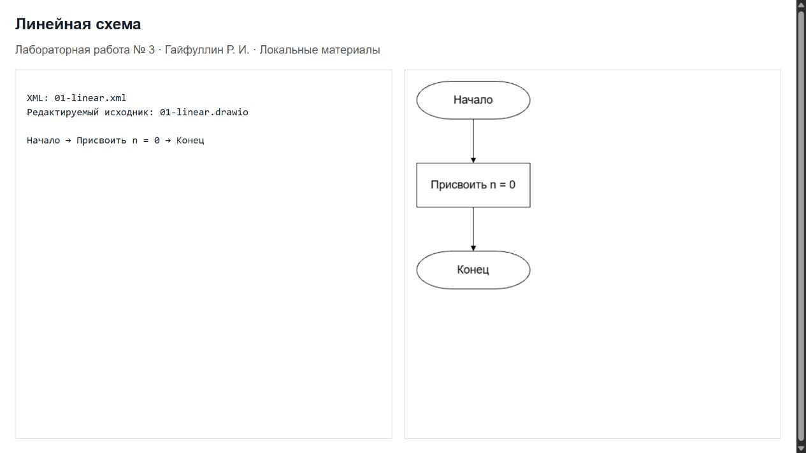
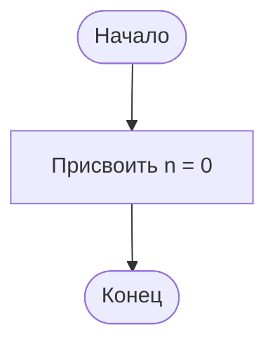
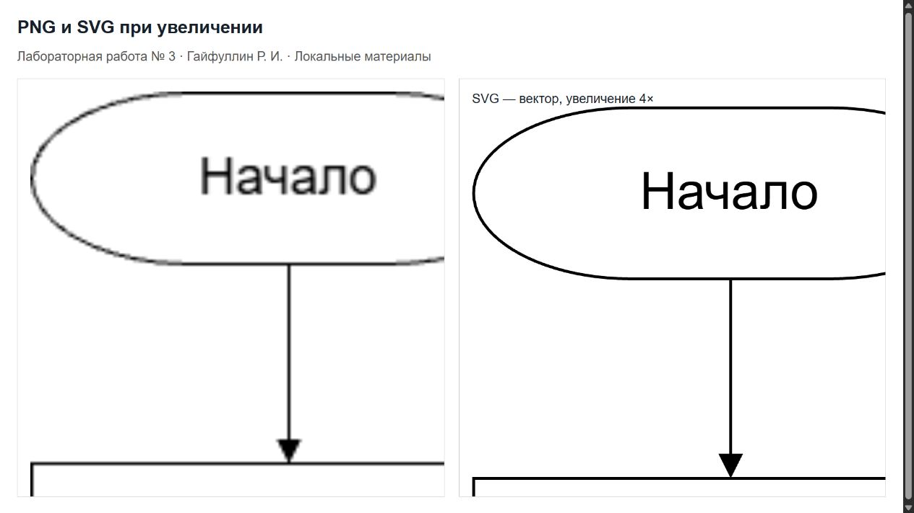
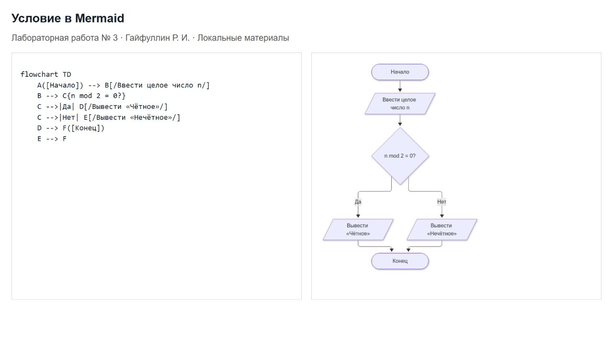
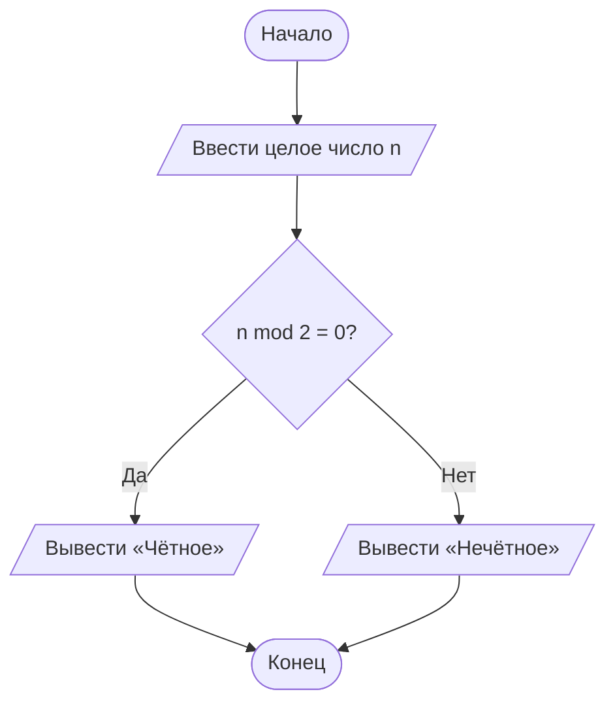
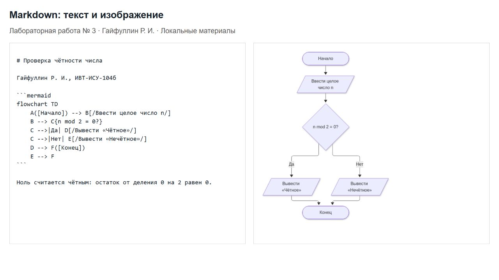
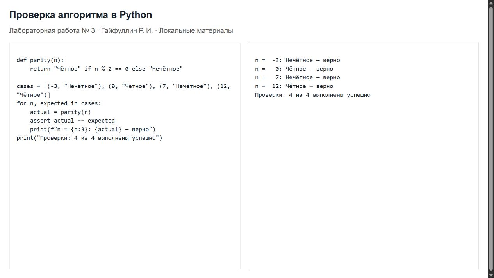
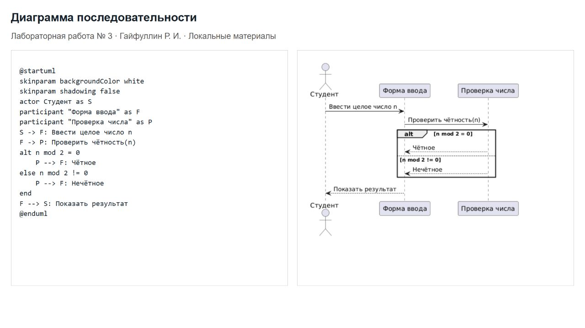
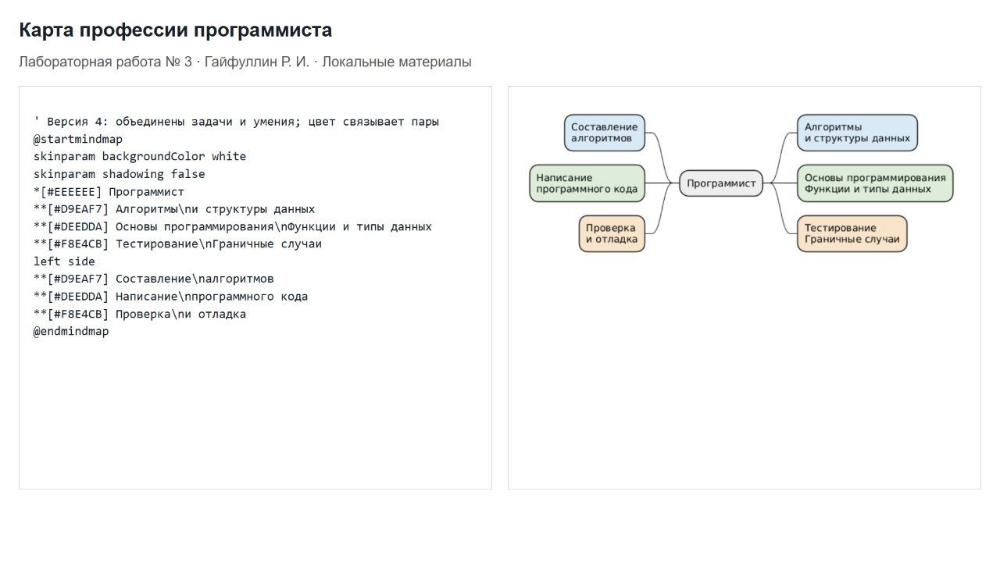

ФГБОУ ВО  
Уфимский университет науки и технологий  
Кафедра технической кибернетики

# Отчёт по лабораторной работе № 3

по дисциплине «Цифровые технологии и искусственный интеллект»

**Выполнил:** Гайфуллин Р. И., ст. гр. ИВТ-ИСУ-104б  
**Проверил:** Зиязетдинов Д. С.  
Уфа 2026

## Цель работы

Научиться строить схемы в Draw.io, Mermaid и PlantUML, вставлять их в Markdown и связывать задачи программиста с необходимыми знаниями.

## Ход работы

### Линейный алгоритм в Draw.io

Алгоритм — это понятная последовательность действий для решения задачи. Само название связано с именем математика аль-Хорезми. На схеме прямоугольник обозначает действие, ромб — условие, параллелограмм — ввод или вывод. Начало и конец обозначают терминатором. Основные обозначения приведены в ГОСТ 19.701–90.

Подготовлена простая схема в формате Draw.io: «Начало», «Присвоить n = 0», «Конец». Блоки соединены двумя стрелками сверху вниз. Исходник сохранён в файле 01-linear.drawio.

*Рисунок 1 – Линейная схема и её исходник*

В этой схеме нет выбора и повторения: все действия выполняются по одному разу.

### Сохранение схемы и сравнение форматов

В папке работы сохранены XML, PNG, SVG и HTML. В XML находятся блоки, их координаты и связи. PNG содержит готовое растровое изображение. SVG хранит векторные элементы. HTML открывает схему на веб-странице через просмотрщик Draw.io.

Для сравнения увеличил одну и ту же часть PNG и SVG в четыре раза. Исходная ширина PNG — 182 пикселя, при просмотре — 728 пикселей.

*Рисунок 2 – Сравнение одного фрагмента PNG и SVG при увеличении 4×*

У PNG стали заметны размытые края букв и линии. В SVG контуры остались чёткими. В Word удобно вставлять PNG, а в Markdown — изображение по относительному пути, например ``.

### Проверка чётности числа в Mermaid

Ту же линейную схему записал кодом Mermaid. Затем добавил ввод числа, условие и два варианта вывода. На вход подаётся целое число n. Если остаток от деления на 2 равен нулю, выводится «Чётное», иначе — «Нечётное».

*Рисунок 3 – Код Mermaid и схема с условием*

flowchart TD задаёт направление сверху вниз. Фигурные скобки создают ромб, а подписи «Да» и «Нет» помогают выбрать нужную ветвь. Обе ветви заканчиваются в одном блоке «Конец». Ноль тоже проходит по ветви «Да»: 0 % 2 = 0.

### Диаграмма в Markdown

В файле even.md схема записана в блоке кода с пометкой mermaid. Рядом сохранены изображения PNG и SVG. На локальной странице показаны исходный Markdown и изображение этой схемы.

*Рисунок 4 – Текст Markdown и соответствующая схема*

Блок mermaid содержит описание диаграммы. Для просмотра нужна программа с поддержкой Mermaid. Если такой поддержки нет, можно вставить готовое изображение по относительному пути. Поэтому рядом с отчётом сохранена папка images, а текстовые исходники находятся в sources.

### Блокнот и проверка алгоритма

Подготовил блокнот Гайфуллин-ЛР3.ipynb, который можно открыть в Google Colab. В этой работе я выполнил его локально в Python. Первая кодовая ячейка переводит описание схемы в UTF-8, сжимает его и кодирует в URL-безопасный Base64. Затем формируется ссылка Mermaid Ink и выводится SVG.

Во второй ячейке функция parity повторяет условие схемы. Для каждого числа assert сравнивает ответ с ожидаемым результатом.

*Рисунок 5 – Локальная проверка Python: код и результаты тестов*

Для −3 и 7 получен ответ «Нечётное», для 0 и 12 — «Чётное». Все четыре проверки прошли. Проверены обе ветви, отрицательное число и ноль.

### Диаграмма последовательности в PlantUML

Построил диаграмму с тремя участниками: студент, форма ввода и проверка числа. Студент вводит n, форма отправляет его на проверку и затем показывает ответ.

*Рисунок 6 – Обмен сообщениями в PlantUML*

Время на диаграмме идёт сверху вниз. Сплошные стрелки показывают запросы, пунктирные — ответы. Блок alt содержит два исхода условия. Вывод результата расположен после alt, потому что ответ нужно показать в обоих случаях.

### Интеллект-карта профессии программиста

Для карты выбрал профессию программиста. В профстандарте 06.001 выделены алгоритмизация задач, написание кода, проверка и отладка. На своей карте я сократил названия и связал эти задачи с нужными знаниями и умениями.

Сохранил четыре версии: корень карты, рабочие задачи, знания и умения, объединённая карта. В итоговой версии задачи расположены слева, знания и умения — справа.

*Рисунок 7 – Задачи программиста и необходимые знания*

Одинаковые цвета обозначают связанные пары. Голубой связывает алгоритмы с их составлением, зелёный — основы программирования с написанием кода, оранжевый — тестирование с проверкой и отладкой. Команда left side переносит ветви влево, а \n разбивает длинную подпись на две строки.

## Вывод

В работе я сделал линейную схему и схему с условием, проверил алгоритм на четырёх числах и показал его работу в UML. В Draw.io удобно двигать блоки вручную, а в Mermaid и PlantUML достаточно изменить текст. Для увеличения лучше подходит SVG. Карта профессии помогла связать составление алгоритма, написание кода и проверку результата.

## Источники и материалы

- Арьков В. Ю. Цифровые технологии и искусственный интеллект. 2024. Глава 3 «Диаграмма как код», с. 74–137.

- [ГОСТ 19.701–90. Схемы алгоритмов, программ, данных и систем.](https://protect.gost.ru/gost/details/0c85e066-f89e-433d-a6d3-b7f746bd0c7c)

- [Draw.io. Форматы экспорта.](https://www.drawio.com/docs/manual/export/export-diagram/)

- [Mermaid. Flowcharts.](https://mermaid.js.org/syntax/flowchart.html)

- [PlantUML. Sequence diagram и MindMap.](https://plantuml.com/mindmap-diagram)

- [Минтруд России. Профстандарт «Программист», приказ № 424н от 20.07.2022.](https://mintrud.gov.ru/docs/mintrud/orders/2403)

## Файлы работы

- [Отчёт Word](Гайфуллин-ЛР3.docx)
- [Блокнот](Гайфуллин-ЛР3.ipynb)
- [Исходники схем](sources/)
- [Подготовка к защите](Защита.md)
